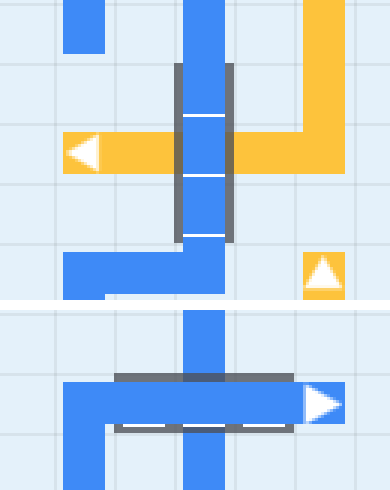
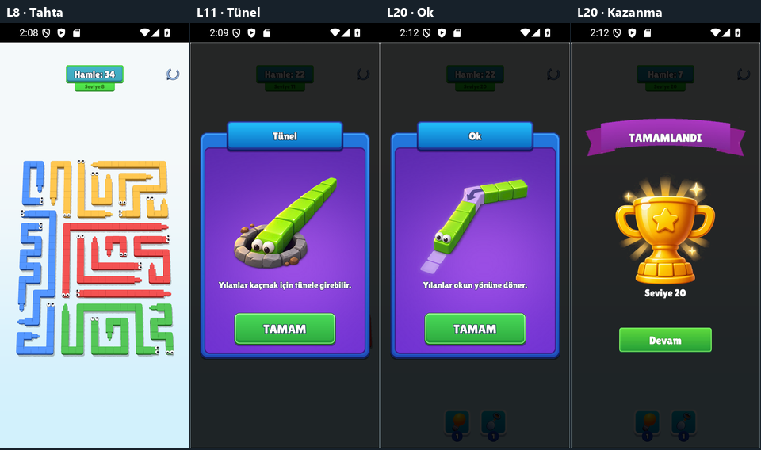

# Snake Block Jam

Oreon Studios Unity case çalışması: Snake Block Jam'in ilk 20 bölümünün Unity klonu. Portre ekranda bir yılanın herhangi bir hücresine dokunarak onu başının baktığı yönde hareket ettirirsiniz; amaç tahtayı boşaltmaktır. Köprüler iki katmanda geçiş sağlar, tüneller kaçış noktasıdır, oklar başın yönünü değiştirir. İpucu kaçabilecek bir yılanı gösterir, Kürek seçtiğiniz yılanı kaldırır.

## Kurulum

| | |
|---|---|
| Unity | **6000.3.28f1** (Unity 6.3 LTS) |
| Render | URP 17.3 |
| Girdi | Input System 1.20.1 (Active Input Handling = Input System Package) |
| Android | IL2CPP, **ARMv7 + ARM64**, min API 25 |

1. Projeyi Unity Hub'dan 6000.3.28f1 ile açın. Android için aynı sürümün **Android Build Support**, SDK, NDK ve OpenJDK modüllerini kurun. Başka paket veya içe aktarma adımı yok.
2. `Assets/_Project/Scenes/Game.unity` sahnesini açıp Play'e basın. Level 1 açılır.
3. APK için **Snake Block Jam → Build → Android APK (Release)** seçin. Çıktı `Builds/Android/SnakeBlockJam.apk`. Builder; paket adını (`com.oreoncase.snakeblockjam`), IL2CPP'yi, ARMv7 + ARM64'ü, portre yönünü ve Android kare temposunu (Optimized Frame Pacing) koddan uygular.
4. Sahne üreticisini (`GameSceneBuilder`) değiştirdiyseniz Play modundan çıkıp **Snake Block Jam → Setup → Build Game Scene** çalıştırın ve sahneyi kaydedin. Normal kullanımda gerekmez.

Release APK varsayılan Android Debug sertifikasıyla imzalanır.

**Oyun akışı:** İlk beş bölümde hamle sayacı görünmez. Sonraki bölümlerde başarısız hamle de bir hamle harcar. L1–L4'te kazanınca sonraki bölüm doğrudan açılır; L5'ten itibaren TAMAMLANDI → Devam, kayıpta HAMLE YOK → Tekrar Dene. Referanstaki gibi oyun içinde Restart butonu yok; bölüm yalnızca HAMLE YOK'tan yeniden başlar. Yılan kaçışı yolu sadece açtığı için hiçbir bölümde takılı kalınmaz. İpucu L13'te, Kürek L18'de açılır; tanıtımdaki ilk kullanımları ücretsizdir (stok düşmez). Yeni mekanikler (köprü L5, tünel L11, ok L20) ilk göründükleri bölümde tanıtım kartıyla gelir. Telefonda uygulama kapanıp açılınca kaldığı bölümden devam eder (editörde sahnedeki bölüm açılır).

**Öğretici ve geri bildirim:** L1'de el ve halka kaçabilecek yılanı gösterir. L2'de ilk dokunuşa kadar bir yılan kısa süre ileri geri hareket eder. İpucu düğmesi hedef yılanı vurgular. L10 ve L14'te köprü üstü veya son kaçış başparmak ve konfetiyle kutlanır (referansta yalnızca bu iki bölümde görüldü). Uzun seriler `Unbelievable! X2` gibi çarpanlarla devam eder.

## Mimari

```text
LevelData / LevelCatalog ──► GameController ◄── InputHandler
                                  │
                             MoveSimulator          (Core: saf C#, Unity'siz)
                                  │ MoveResult
                              BoardState
                                  │
                        BoardView / SnakeView       (Game: görünüm ve his)
                        HUD / sonuç / ses / titreşim
```

- **Core** (`Scripts/Core`, `noEngineReferences`): `BoardState`, `MoveSimulator`, `MoveResult`, köprü/tünel/ok tanımları ve `Solver`. Kurallar burada; Unity'den bağımsız ve EditMode testleriyle doğrulanır.
- **Game** (`Scripts/Game`):
  - `Board/`: `BoardView` (tahtanın akışı: yılan görünümleri, kaçış/çarpma/kürek, İpucu vurgusu, olaylar) ve `SnakeView` (açılış çizimi, kaçış, çarpma, dürtme, hareket izi üzerindeki duruş). Yardımcıları tek sorumlulukludur:
    - Tahta: `BoardMaterials` (runtime materyaller), `BoardDecorBuilder` (zemin, noktalar, köprü, tünel, ok, kıymık sistemleri), `SnakePicker` (dokunma seçimi ve parmak toleransı), `ClearWave` (bölüm sonu dalgası), `CameraFit` (kamera çerçevesi).
    - Yılan: `SnakeFace` (göz, dil, sersem gözler), `SnakeBodyBaker` (dururken tek mesh), `SnakeDent` (göçük), `SnakeShovelRemoval` ve `SnakeChipEmitter` (kürek ve kıymıklar), `SnakeParts` (parça kurulumu).
    - Diğer: `BridgeView`, `BlockMesh`, `ArrowMesh`, `HawkEye`, `DebrisBurst`.
  - `Gameplay/`: `GameController` (akış, evreler, booster'lar), `InputHandler` (Pointer API, mouse ve dokunma ortak), `FeelSettings` (bütün süre ve hızlar tek ScriptableObject'te).
  - `UI/`: HUD, sonuç ekranları, booster'lar, geri bildirim (vinyet, seri yazıları), tanıtım kartları.
  - `Audio/`: `SfxPlayer` (olaylara bağlı sesler), `SfxSynth` (kodla üretilen kayma sesi), `Haptics` (Android `VibrationEffect`).
- **Editor** (`Scripts/Editor`): Level Editor, JSON içe aktarıcı, sahne üreticisi, Android builder.

## Önemli teknik kararlar

1. **Hamle dokunulduğu anda çözülür, görünüm sonradan oynar.** `MoveSimulator` sonucu hesaplar, `BoardState` hemen günceller; animasyon modeli beklemez. Referansta kaçış sürerken başka yılanlara dokunulabildiği ve hareket eden yılanların birbirinin içinden geçtiği görüldüğü için tick tabanlı bir simülasyon yerine bu model seçildi. Giriş yalnızca başarısız hamlenin gidiş-dönüşü boyunca kilitlenir.
2. **Köprüde hücre başına iki katman.** Doluluk `(hücre, katman)` çifti olarak tutulur (`Ground`, `BridgeTop`). Böylece aynı hücrede biri üstte biri altta iki yılan bulunabilir ve bir yılan aynı köprü hücresinden bir kez alttan bir kez üstten geçebilir (L19). Üst kata yalnızca köprü uçlarından, yol doğrultusunda girilir.
3. **Tek çözücü.** Bir yılanın kaçması diğerlerinin yolunu açar. Bu yüzden açgözlü (greedy) çözüm, bölüm çözülebiliyorsa bir çözüm bulur. Aynı `Solver` Level Editor'de bölümü doğrular ve İpucu, dokunma öğreticisi ve dürtme için kaçabilen hedefi seçer.
4. **Kanıta dayalı kurallar.** Her mekanik referans kayıtlarından "doğrulandı / gözlendi / ölçüldü / varsayım" olarak etiketlendi. Doğrulanmamış davranış kural olarak kodlanmadı; zorunlu varsayımlar (ör. yılanın kendi gövdesinin engel olmaması) kodda ve bu README'de belirtildi.
5. **Ayarlar veride, kural kodda.** Bölümler `LevelData` asset'leri (yerleşim, stok, booster açılışı, tanıtım kartı, kamera çerçevesi), bütün süre ve hızlar `FeelSettings` asset'i. Yeni bölüm veya his ayarı için kod değişmez.
6. **Görünenle seçim.** Dokunma, ekrandan atılan ışının yılanın görünen parçalarıyla (blok, göz, dil, kuyruk ucu) kesişmesiyle seçilir; tam isabet yoksa ~3 mm'lik parmak toleransı uygulanır. Eğik kamerada sadece blok üst yüzüne bakan eski yöntem, 20 bölümde göz ve dil üzerindeki örnek noktaların %12–48'ini kaçırıyordu; yeni yöntemde kaçırma yok.
7. **Cihazda ölçerek optimizasyon.** Galaxy A13'te darboğaz önce GPU, sonra çizim çağrısı sayısı çıktı. Duran yılanların gövdesi tek mesh'te birleştirilir (yılan başına ~40 yerine 2 çizim çağrısı; hareket, göçük veya kürek başlarken parçalara dönülür). Mobil grafik ayarında HDR kapatıldı, MSAA 2× yapıldı. Telefonda sabit 30 FPS ve tam çözünürlük; masaüstü ve editörde 60.

## Level Editor

**Snake Block Jam → Level Editor** menüsünü açın.

1. Üstteki alandan bölüm seçin. **Kopyala** ile bir bölümden başlayabilir veya **Yeni** ile boş tahta oluşturabilirsiniz.
2. Yılan ve köprü araçlarıyla sürükleyerek çizin. Tünel ve yön okunu hücreye tıklayarak yerleştirin. Köprü hücrelerinde **Zemin / Üst** seçimi yüzeyi belirler.
   - Yılan baştan kuyruğa çizilir. Çok hücreli yılanın yönü gövdeden gelir (boyun → baş), bu yüzden "Yön" alanı kilitlidir. Yılanı **Seç** aracıyla seçip **Yönü ters çevir** ile baş ve kuyruğu yer değiştirebilirsiniz. Tek hücreli yılanda yön elle seçilir; buton yönü 180° döndürür.
3. Doğrulama panelindeki hataları düzeltin (çakışma, tahta dışı, çözülemezlik vb.).
4. **Kaydet**; yeni bölümse **Kataloğa ekle**.
5. **▶ Oyna** seçili bölümü doğrudan oyunda başlatır.

Bölümler `Assets/_Project/Data/Levels/Level_NN.asset` (`LevelData`) dosyalarıdır, oyun bunları `Data/LevelCatalog.asset` sırasıyla yükler. 20 bölümün hepsi bu sistem üzerinden çalışır; gameplay koduna dokunmadan bölüm eklenip düzenlenebilir. Booster'ların açık olup olmadığı, TAMAMLANDI ekranı, tanıtım kartı ve kamera çerçevesi de bölüm verisindedir; oyun kodunda level numarasına bağlı kural yoktur.



## Referans analizi ve game feel

Mekanikler ve zamanlamalar referans oyunun 21 oynanış kaydından (L1–L20, 720 × 1616) ölçüldü. Kayıtlar değişken kare hızlı olduğu için ölçümler kare sayısıyla değil, MP4 konteynerindeki zaman damgalarıyla (PTS) yapıldı; tek olay çözünürlüğü ~±25 ms. Kayıtlarda dokunma göstergesi olmadığından L6'dan sonra hamle sayacının değiştiği an dokunuş anı kabul edildi. Ölçülen değerler `FeelSettings` asset'inde tek yerde tutulur, her alanın açıklamasında kaynağı yazar.

| Davranış | Referansta ölçülen | Klonda |
|---|---|---|
| Kaçış | Medyan ~60 hücre/sn, ilk karede tam hız; kaçış sürerken giriş kilitlenmiyor | 60 hücre/sn, rampa yok, kaçışlar paralel |
| Çarpma | Temas anında çarpılan yılan ~½ hücre göçer, hareket edenin renginde küpler saçılır, ~0,125 sn sonra kırmızı vinyet | Aynı sıra ve süreler; çarpma hızı 40 hücre/sn (proje kararı) |
| Level sonu | ~0,28 sn boş tahta → ALL CLEAR ~1,3 sn → nokta dalgası → TAMAMLANDI'ya sert kesme | Aynı sıra ve süreler |

Ölçülemeyenler (ör. çarpma sonrası giriş kilidinin kesin süresi, şahin gözünün tetikleyicisi, titreşim) kodda varsayım olarak işaretlendi.

## Doğrulama

- **Otomatik testler:** Unity Test Runner ile 401 EditMode ve 64 PlayMode testi (22 Kasım 2026, temiz klonda batchmode). Kurallar, hamle simülasyonu, köprü/tünel/ok etkileşimleri, booster'lar, level verisi, editör doğrulaması, dokunma seçimi, kazanma/kaybetme akışı ve his eğrileri kapsanır.
- **Dayanıklılık testi (`StressTests`):** 20 bölümde rastgele oynayan test. Dokunuşlar (yılan, boş hücre, ekran noktası, aynı karede hızlı seri), İpucu, Kürek, kart kapatma, pencere butonu ve bölümü yeniden başlatma karışık gelir; bitiş ve kayıp ekranlarında da dokunulur. Hata, exception veya takılma testi düşürür. Ayrıca L1 → L20 → L1 tam tur oynanır. Teslim öncesi 3 turla koşuldu: ~4.950 hamle, hata yok.
- **Fiziksel cihaz (Samsung Galaxy A13, Android 12, Mali-G52):**
  - 20 bölüm baştan sona oynandı (performans optimizasyonu öncesi build): 20 ALL CLEAR, 1 HAMLE YOK, 419 hamle. Unity hatası, exception, çökme veya ANR görülmedi.
  - **Son tur (22 Kasım, temiz klondan derlenen release APK):** 20 bölüm oynandı, uygulama arada kapatılıp açıldı. Toplam 460 hamle: 292 kaçış, 38 tünel, 130 çarpma, 2 Kürek. 3 HAMLE YOK alındı, hepsi Tekrar Dene ile geçildi. Hata, exception, çökme veya ANR yok.
    - Kare temposu: 13.882 karenin %99,5'i 33 ms aralıkla geldi (ortalama 29,9 FPS). 100 ms üstü tek kare oldu.
    - Bellek (RSS): ilk bölümlerde yüklemeyle 234 → ~270 MB, sonra L20'ye kadar 266–282 MB'ta sabit; sızıntı yok.
    - Pil sıcaklığı 30,0 → 33,8 °C; ısınmada FPS düşüşü görülmedi.
  - Dokunuştan hamleye gecikme: medyan 15 ms.
  - Bellek 270–341 MB, sızıntı yok.
  - Optimizasyon sonrası tam çözünürlükte bir kare ~22 ms; L1'de karelerin %97,8'i tam 33 ms (sabit 30 FPS).
  - Bellek ayırma (development build, otomatik oynama L1–L9): boşta kare başına ≈ 0 B; ayırma sadece dokunuş anında (kare başı ortalama 0,5–1,5 KB) ve bölüm yüklemede (tek seferlik 130–570 KB). GC toplaması ~10 sn'de bir, Mono heap 3–4 MB.
- **Bölüm düzenleri:** 20 bölümün render'ı, referans videolardaki açılış sonrası karelerle renk maskesiyle karşılaştırıldı. L15'te 11 yılanın başı geride okunmuştu (başlangıç karesi açılış animasyonu bitmeden çekilmiş); düzeltildi ve hücre hücre eşleşiyor. L10/L19'daki kısa köprüler 1 hücreye düşürüldü. 21 Kasım'da ikinci bir kontrol yapıldı: her bölümün videosu bölüm sonuna kadar tarandı, yılanlar kaçtıkça açılan grid noktaları ve başlangıçtaki her hücre bizim render'la karşılaştırıldı. Noktalar 20 bölümde de uyuşuyor. L4'te bir yılanın kuyruğu bir hücre kısaydı, düzeltildi. 22 Kasım: L15'te aşağı bakan 6 yılanın başı bir hücre fazla uzundu (önündeki yılanla iç içe görünüyordu). Diğer bölümlerdeki 55 aşağı bakan başla karşılaştırılarak düzeltildi. 331 yılanın rengi referansla yılan yılan karşılaştırıldı; hepsi aynı (ton farkı ΔE ≤ 2,4).
- **Emülatör:** Android 15 Pixel 8 AVD'de L1–L20 geçildi. 21 Kasım: Android 16 AVD'de release APK ile Android `monkey` testi yapıldı (20.000 rastgele olay; dokunma, kaydırma, uygulamadan çıkıp dönme, sistem tuşları). Sonuç: 790 hamle, L1–L6, çökme/ANR/Unity hatası yok. Uygulama zorla kapatılıp açılınca kaldığı bölümden devam etti. Not: Aynı gün Pixel 8 AVD'de (16 KB sayfa boyutlu x86_64 imaj, ps16k) emülatörün ARM çeviri katmanı açılışta çöktü (`berberis: Cannot process signal 11`, Vulkan başlatılırken). Çöküş çeviri katmanının içinde, oyun kodunda değil. Gerçek ARM cihazlarda çeviri katmanı yok.



## Kullanılan araçlar

- **OpenAI Codex:** Uygulama, test yürütme ve referans karelerin karşılaştırılması.
- **Claude Code (Anthropic):** Fiziksel cihaz testi ve hata ayıklama (`adb` ile dokunuş, kare süresi, GPU/CPU, bellek ölçümü), dokunma seçimi ve parmak toleransı, çarpma titreşimi, açılış sesi senkronu, şahin gözü, performans analizi ve optimizasyonu (gövde birleştirme, mesh sadeleştirme, mobil grafik ayarı, kare temposu).
- **REA (reverse-engineer-anything):** Referans oyunun APK'sının dosya envanteri. Unity serileştirilmiş dosyaları (`globalgamemanagers`, `level0`, `resources.assets`) kendi Python betikleriyle salt okunur incelendi; Unity sürümü, sınıf adları ve ayarlar not edildi. Koddan veya asset'lerden hiçbir şey projeye alınmadı. Sınıf adları yalnızca yorum (INFERRED) olarak kullanıldı; oynanış kurallarının kaynağı referans videoları ve ekran görüntüleri.
- **ImageGen:** Özgün kupa, Hard ikonu ve köprü/tünel/ok tanıtım çizimleri (kullanıcı onayıyla).
- **Game feel analizi:** REA envanterinden sonra 21 referans kaydı için Python ile yazılmış salt okunur araçlar: MP4 konteyner zaman damgası okuma, Windows Media Foundation ile kare çözme, dokunuş başına hareket ölçümü (kaçış hızı ve süresi), vinyet ve ses başlangıcı tespiti, zaman damgalı kare şeritleri.
- FFmpeg, Python, Pillow ve NumPy: referans video/ses incelemesi, görsel hazırlama ve kayıt kodlama.
- Font: Lilita One Regular (Juan Montoreano, OFL), `Assets/_Project/Art/Fonts/`.

## Bilinen eksikler ve kararlar

- **30 FPS:** Giriş seviyesi cihazlarda (Mali-G52) 60 FPS ancak çözünürlük ve kenar yumuşatma belirgin düşürülürse tutuyor. Görüntü kalitesi için telefonda sabit 30 FPS seçildi; hızlı kaçışlar kare başına 2 hücre ilerler.
  - 22 Kasım'da tam çözünürlükte (1080×2408) daha yüksek ayarlar Galaxy A13'te ölçüldü (L7, L15, L19; GPU süresi/kare): mevcut 2× MSAA ~18 ms, yumuşak gölge Orta ~24 ms, 4× MSAA ~28 ms (+70 MB bellek), ikisi birlikte ~31 ms. Ekran görüntülerinde fark ayırt edilemedi. 30 FPS'in ısınmada da sabit kalması için mevcut ayar korundu.
- **Açılış çizimi:** Referansta L1 yaklaşık 0,05 sn'de çiziliyor. Klonda kısa yılanlar en az 0,3 sn'de çiziliyor ki ilk bölümlerde çizim fark edilsin (bilinçli sapma). Uzun yılanlar referans hızında (190 hücre/sn).
- **Hard bandı:** Bant ekrandayken (~1,4 sn) tahtaya dokunuş geçmez. Tanıtım kartlarında da aynı.
- **Referansta ölçülemeyenler (varsayım):** Titreşimin, şahin gözünün ve başparmağın kesin tetikleri, yüz animasyonlarının periyotları ve `X3` ile sonrasının seri eşikleri açık.
  - Başparmak referansta 20 bölümde yalnızca 3 kez görüldü. Klon onu sadece bu bölümlerde (L10, L14) gösteriyor: köprü üstü veya son kaçışta, bölüm başına en çok 2 kez.
  - Seriler: 23. başarılı kaçışta `X2`, 28.'de `X3`, sonra her beş kaçışta bir yeni çarpan.
- **Kapsam dışı (case gereği):** Ana menü, level seçimi, mağaza, coin, kalp, reklam ve ek hamle satışı. Booster stoğu her bölümün başında referans karelerinden okunan değerle başlar. L20'den sonra Devam ilk bölüme döner.
- **Samsung cihazlar:** Ekranın en altına dokununca Samsung Game Booster paneli açılabilir; bu sırada oyun duraklar. Sistem davranışıdır.
